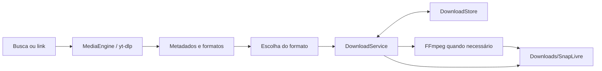

# Arquitetura e dados locais

Aplicativo escrito em Java. A interface envia pesquisas e links ao extrator; o serviço mantém a fila e exporta os arquivos.

| Componente | Responsabilidade |
| --- | --- |
| MainActivity | Busca, formatos, fila, favoritos, histórico e ajustes |
| BrowserActivity | WebView, atalhos e identificação de mídia |
| MediaEngine | Runtime, busca, análise de links e atualização do yt-dlp |
| DownloadService | Fila sequencial, retomada, conversão, exportação e notificações |
| DownloadStore | Persistência e restauração das tarefas |
| MediaItem e Ui | Modelo de mídia e auxiliares de interface |

## Persistência e rede

Favoritos, histórico, preferências e estados das tarefas ficam localmente. Os arquivos concluídos são exportados para **Downloads/SnapLivre**. Arquivos parciais são preservados ao pausar. Tarefas interrompidas pelo encerramento do processo são restauradas pausadas para retomada manual.

O código próprio não inclui telemetria ou SDK de anúncios. Pesquisas, miniaturas, páginas e transferências fazem conexões aos serviços acessados. A atualização do extrator consulta o projeto oficial. Páginas externas podem exibir publicidade mesmo com a lista de bloqueio de domínios do navegador.

O manifesto desabilita backup e não declara permissões de sobreposição, identificação de publicidade ou consulta de todos os aplicativos. Cookies do WebView não são transferidos automaticamente ao extrator.
